# Entrega del 10/11/2026: qué se hizo y cómo se verificó

Estado del pedido «producto terminado»: los dos funnels pulidos, la app del comprador, la conexión con el checkout de Hilvapay y todo listo para probar con anuncios.

Lo que falta para salir está en el README, en [«Qué falta para salir con anuncios»](../README.md#qué-falta-para-salir-con-anuncios).

## En resumen

- Todo está en la rama `main`.
- `npm test`: 112 de 112 bien, ninguno salteado.
- Lighthouse en celular: 100 en rendimiento, accesibilidad y buenas prácticas en los dos quiz, las dos ofertas y la app.
- Prueba de humo tipo producción (nginx real y el servicio, en Docker): 42 de 42 bien.
- El botón de compra todavía no cobra: faltan los links de pago de Hilvapay. Hasta entonces dice «Todavía no abrimos el pago» y solo cuenta el clic.

## Lo que se pidió y en qué quedó

### App del comprador (PWA)

- [x] Manifest completo:
  - nombre, íconos de 192 y 512 y versión maskable;
  - colores, `standalone`, `start_url` e idioma;
  - capturas y accesos directos a Hoy y Progreso.
- [x] Service worker: la app funciona sin conexión con lo que ya cargó, tiene pantalla sin conexión y avisa cuando hay una versión nueva.
- [x] Instalable:
  - Chrome no marca errores;
  - en iPhone, con Compartir → Agregar a inicio;
  - si la abren desde Instagram o Facebook, avisa que hay que abrirla en Safari o Chrome.
- [x] Lighthouse de 90 o más (ver abajo).
- [x] Recorrido completo:
  - `/gracias/` → app;
  - plan según el perfil (peleador o bajar de peso) y el nivel;
  - sesión con timer y lugar para el video;
  - progreso.
- [x] Contenido:
  - 4 semanas, 4 niveles y 2 perfiles, con 72 sesiones por perfil;
  - drills y la guía bono;
  - las semanas llevan los títulos de la oferta.
- [x] Solo para compradores: el servicio entrega el plan solo a accesos de compras pagadas. Desde otro celu, «Recuperá tu link» lo manda de nuevo al mail de la compra.
- [x] Todas las pantallas y estados:
  - bienvenida, Hoy, plan, sesión, descanso y celebración;
  - progreso y perfil;
  - pago pendiente, sin conexión, error y acceso dado de baja.
- [x] Botones de 44 px o más, movimiento reducido respetado y sin scroll roto.
- [x] `appUrl: '/app/'` cargado.
- [ ] Videos de los ejercicios, drills y guía: tienen el lugar reservado (`video: ''`). Mientras tanto se ve el muñeco con las indicaciones.
- [ ] Revisión del plan por Néstor J. Medina.
- [ ] Prueba en un iPhone y un Android de verdad.

### Imágenes

- [x] Foto del especialista e imagen de la noticia: tienen el lugar reservado; hoy se ven las iniciales y un ícono.
- [x] Los 5 muñecos nuevos del funnel de peso, revisados contra los 35 originales. Las correcciones están en `docs/pendientes-imagenes.md`, porque no se generaron imágenes nuevas, como se pidió.
- [x] Auditoría de imágenes de los dos funnels:
  - ninguna rota ni faltante;
  - todas en WebP, con ancho y alto;
  - los 3 muñecos de las medidas tienen versión `@2x`.
- [x] Íconos de la app, favicon e imágenes para compartir de 1200×630, hechos con código y sin IA.
- [x] Videos preparados para iPhone: `playsinline`, `muted` como atributo, sin sonido y con póster.
- [ ] Rehacer los 5 muñecos de peso, los de las medidas a 720×960 y los pósters, cuando se puedan generar imágenes.

### Pulido de los dos funnels

- [x] Auditoría en 6 tamaños (360×640, 390×844, 412×915, 768×1024, 1280×600 y 1280×800), con 707 capturas, y corrección de lo encontrado. Detalle en [`auditoria-funnels.md`](auditoria-funnels.md).
- [x] Contador, barra fija y videos como dice el README.
- [x] `/gracias/` y las legales dicen lo que de verdad guarda y manda el sistema. `contacto` y `responsable` están vacíos, con un texto de respaldo.
- [x] Metadatos en todas las páginas (título, descripción, Open Graph, favicon y color) y `robots.txt`.
- [x] Accesibilidad: foco visible, contraste AA, textos alternativos, etiquetas y teclado. Lighthouse da 100.

### Medición

- [x] Clics de compra por página y por funnel (`/api/click`).
- [x] La campaña del anuncio (`utm_*`, `fbclid`, `ttclid` y `gclid`) pasa del quiz a la oferta y de ahí al link de Hilvapay.
- [x] Compras atribuidas a su campaña (el aviso de Hilvapay la trae) y reporte con `npm run reporte`.
- [x] Meta Conversions API (Purchase e InitiateCheckout) desde el servidor. Está apagada hasta tener el píxel y el token.
- [x] URL de cada funnel para los anuncios: en el README y en `deploy/README.md`, punto 10.

### Publicación

- [x] `prueba-quiz/nginx.conf` con:
  - HTTPS y cabeceras de seguridad;
  - caché y la política de contenido (CSP);
  - el servicio y las rutas de la app.
- [x] Guía paso a paso para el VPS: [`deploy/README.md`](../deploy/README.md).
- [x] Prueba de humo tipo producción: [`deploy/prueba-de-humo/`](../deploy/prueba-de-humo/).
- [ ] Publicar en el VPS (lo hace el cliente con la guía).

## Cómo se verificó

### Tests

`npm test` da 112 de 112 bien, ninguno salteado. Incluye tests que abren Chrome y recorren:

- los dos funnels en varios tamaños, sin scroll en ninguna pantalla del quiz;
- la app completa, con timer, progreso, sin conexión e instalación;
- el link de pago con la campaña.

Los demás tests prueban:

- el servicio: avisos de Hilvapay, acceso, progreso, mails y Meta, todo sin salir a internet;
- el contenido del plan;
- las reglas del README.

### Lighthouse

Lighthouse 13.6.0 en modo celular, con 4G lento y CPU 4x simulados. Se corrió el 10/11/2026 contra el nginx real con HTTPS de la prueba de humo. Los reportes completos (se abren en el navegador) están en [`lighthouse/`](lighthouse/).

| Página | Rendimiento | Accesibilidad | Buenas prácticas | SEO | FCP | LCP | CLS |
|---|---|---|---|---|---|---|---|
| `/quiz/` | 100 | 100 | 100 | 66 | 0,9 s | 1,2 s | 0 |
| `/quiz-peso/` | 100 | 100 | 100 | 66 | 0,9 s | 1,2 s | 0 |
| `/oferta/` | 100 | 100 | 100 | 63 | 1,1 s | 1,1 s | 0 |
| `/oferta-peso/` | 100 | 100 | 100 | 63 | 1,0 s | 1,0 s | 0 |
| `/app/<acceso>/` | 100 | 100 | 100 | 58 | 0,9 s | 1,4 s | 0 |

- **SEO:** da menos a propósito, porque las páginas tienen `noindex`: no tienen que aparecer en Google.
- **PWA:** Lighthouse ya no tiene esa categoría. La instalación se controla en la prueba de humo.
- **NO_FCP en la app:** Lighthouse sin pantalla muchas veces da ese error («no pintó nada») en la app.
  - No es la app: el trace muestra que pinta a los pocos milisegundos, pero Chrome abre además un marco principal vacío y Lighthouse sigue a ese.
  - El script lo repite hasta 5 veces.
- **Variación:** una corrida suelta puede dar menos rendimiento si la compu está ocupada. Hoy, `/oferta-peso/` dio 100 en una corrida y 69 en la otra.

Para repetirlo: `sh deploy/prueba-de-humo/lighthouse.sh` (ver [`deploy/prueba-de-humo/`](../deploy/prueba-de-humo/)).

### Prueba de humo tipo producción

nginx con `prueba-quiz/nginx.conf` y el servicio Node, en Docker, recorridos con Chrome como un comprador. Dio **42 de 42 bien**. El detalle de qué controla y cómo se corre está en [`deploy/prueba-de-humo/`](../deploy/prueba-de-humo/).

Encontró un error real, que se corrigió con su test (commit `132c8af`): `/app/<acceso>` sin la barra final redirigía a `/app/GET/`.

### Capturas de la app

En 390×844, con un comprador de prueba.

| | | | |
|---|---|---|---|
| 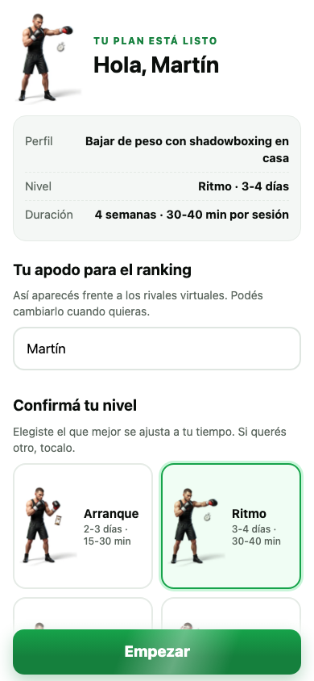 | 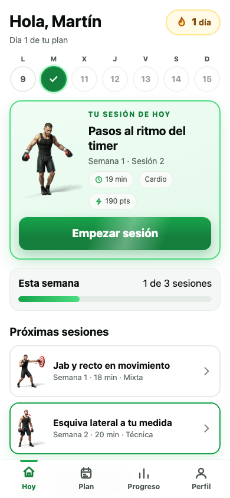 | 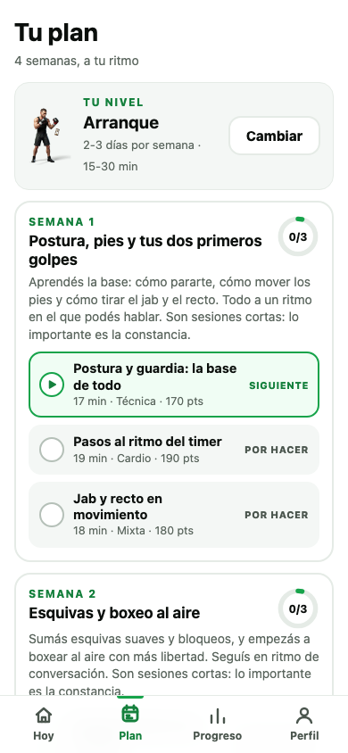 | 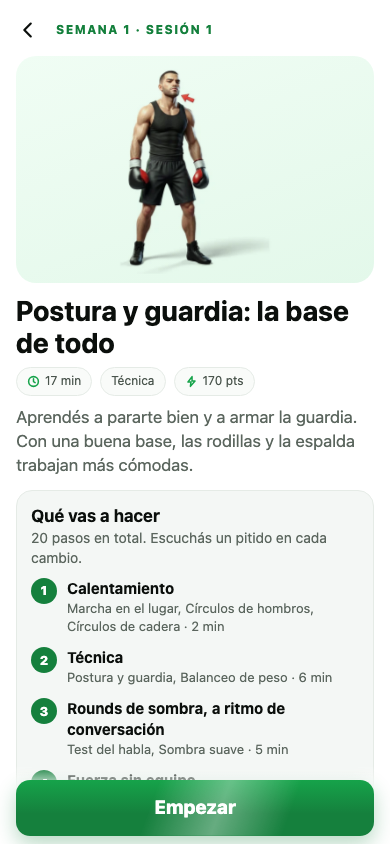 |
| Bienvenida | Hoy | Plan | Antes de la sesión |
| 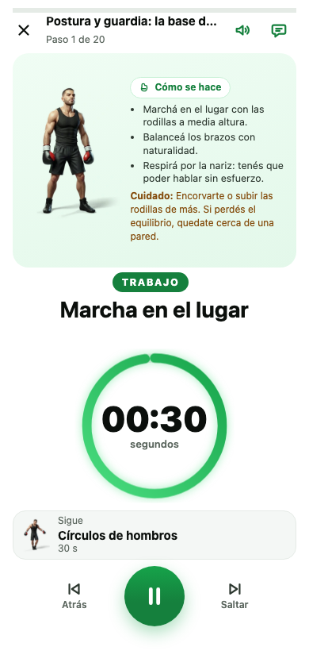 | 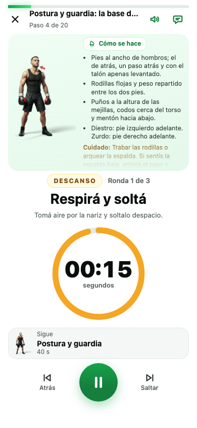 | 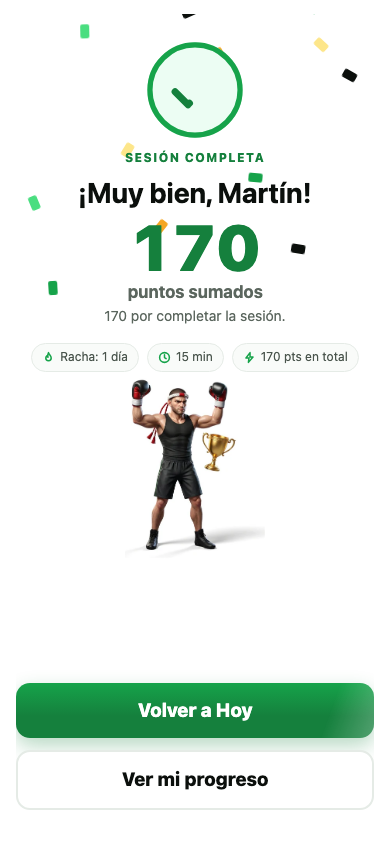 | 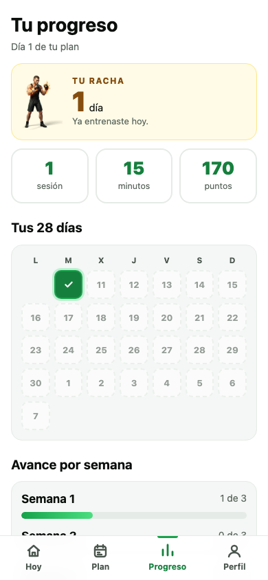 |
| Sesión con timer | Descanso | Sesión completa | Progreso |
| 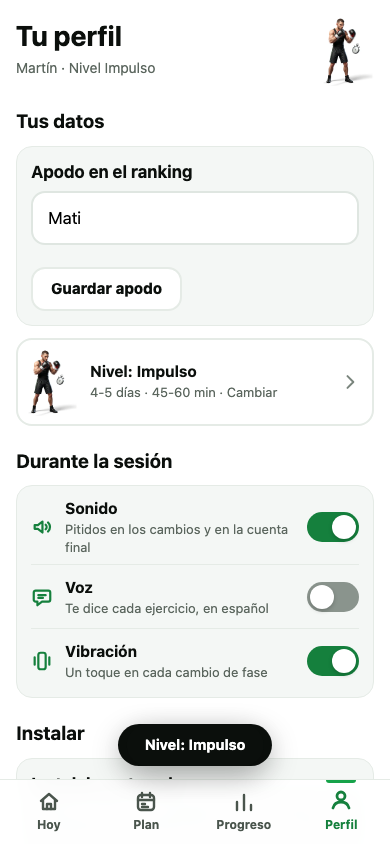 | 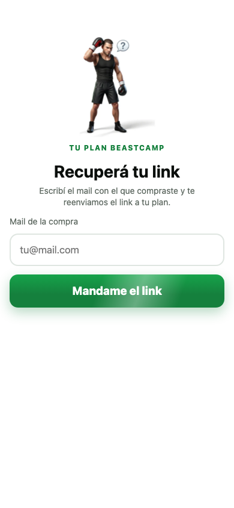 | 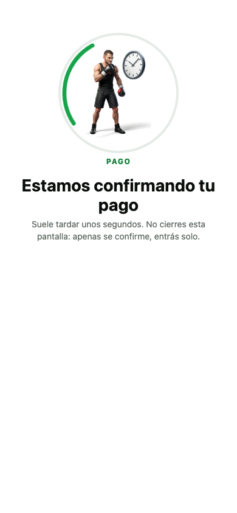 | 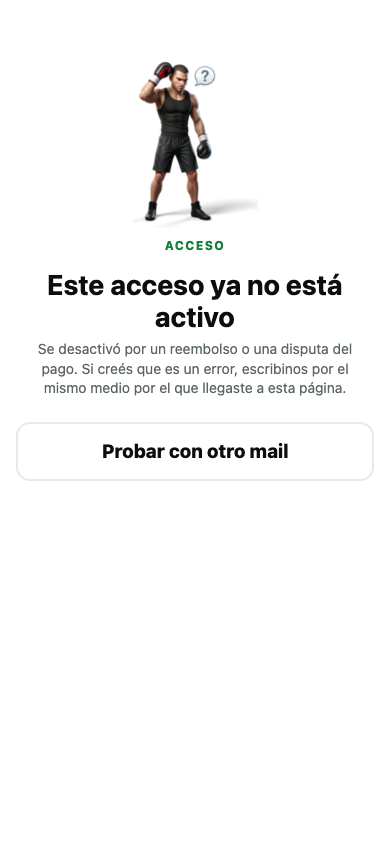 |
| Perfil | Recuperar el link | Pago pendiente | Acceso dado de baja |
| 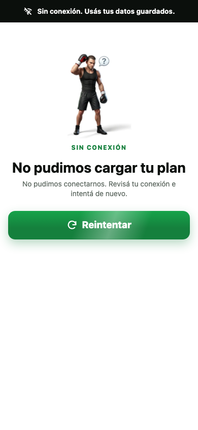 | | | |
| Sin conexión y sin plan guardado | | | |

Para sacarlas de nuevo: `CAPTURAS_DIR=carpeta node --disable-warning=MODULE_TYPELESS_PACKAGE_JSON --experimental-strip-types --test tests/pantallas-app.test.ts`.

## Decisiones tomadas

- **Acceso como en hilvalma:** un link personal, `/app/<acceso>/`, que llega por mail y está en la página de gracias, sin usuario ni contraseña. Un reembolso o una disputa dan de baja el acceso solo si en Hilvapay se configuran esos dos avisos.
- **Ranking:** contra rivales virtuales que genera la app, marcados como virtuales. No se muestran compradores inventados.
- **Meta, solo desde el servidor:** las páginas no cargan código de Meta. Mientras Meta no esté configurado, el servicio no guarda la IP ni el navegador del comprador.
- **Salud:** el aviso de consultar al médico está en la guía y en la bienvenida de la app.
- **Escritorio:** el video va en un recuadro redondeado. En celular se ve igual que antes.
- **Pruebas:** todo se probó con Chrome simulando celulares, sin túnel ni celulares de verdad.

## Qué no se subió al repo y por qué

- **Capturas de trabajo:** las 707 capturas de la auditoría y las de antes y después del pulido, unos 190 MB en total. Se vuelven a sacar con `CAPTURAS_DIR=carpeta` en los tests de pantallas.
- **Datos crudos de Lighthouse:** los traces y los JSON. Alcanza con los reportes HTML.
- **Prueba de humo:** el certificado y los datos se crean y se borran en cada corrida.
- **Claves, mails y archivos `.env`:** nunca van al repo.
- **Notas internas de trabajo:** reparto de tareas y borradores.
